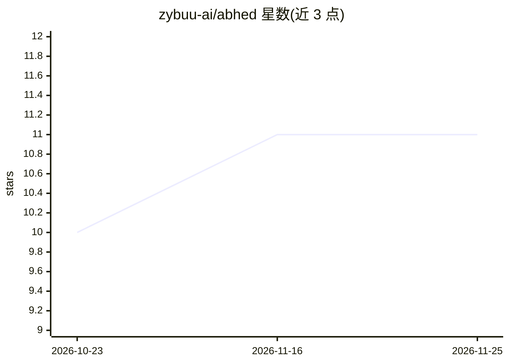

# zybuu-ai/abhed

⭐ 11 · Go · Apache-2.0 · 推送 2026-11-17 · [GitHub](https://github.com/zybuu-ai/abhed) · [官网](https://zybuu.com/abhed/) · 组织维护

**面向数据不出域场景的本地化 agent 运行平台（Go 单二进制）**

以静态 Go 二进制分发的 on-prem agent 平台（deep agent harness），提供 CLI、Web 控制台与 REST/SSE API 三种入口。核心机制：provider 抽象层对接任意 OpenAI 兼容端点，策略引擎对每次工具调用做允许/拒绝/确认裁决，执行沙箱（Seatbelt/bubblewrap/OCI/gVisor）隔离命令，事件溯源记录全部动作并支持会话回放。需要用户自行配置模型端点与工作区信任；离线签名包校验与部分企业功能归入 Enterprise Edition。

## 筛选速览

| 维度 | 判定 | 备注 |
|---|---|---|
| AI 角色 | `ai-ecosystem` | LLM/agent 周边工具 |
| 许可风险 | `permissive` | Apache-2.0 |
| 部署形态 | `None` |  |
| 模型依赖 | local-ok | 支持本地模型 |
| 硬件要求 | — | 无带数字的原话,不猜 |
| 安装摩擦 | `low` | 无编译、无系统依赖或容器化 |
| 成熟度 | — | 结构信号不足 |

## 能力要点

- 事件溯源执行循环，8 种终止原因，支持回放、fork 与导出
- 策略引擎：deny 绝对生效，破坏性命令始终需确认
- 沙箱支持 Seatbelt/bubblewrap/OCI/gVisor，24 项对抗攻击测试
- MCP 网关含工具投毒防御，混合检索（符号/BM25/向量）

## 适用场景

- 在内网或隔离环境中运行能修改代码、执行命令的编程 agent
- 对 agent 每次工具调用做策略管控并留存审计记录
- 通过 vLLM/Ollama 等本地推理栈驱动 agent 而数据不外发

## 场景标签

`Agent 框架` `编码 Agent` `模型网关` · 领域:Agent 开发

## 证据(README 行号)

> L16: An on-prem, air-gap-capable deep agent platform. Model-agnostic by construction:
> L130: |OpenAI-compatible adapter, streaming, reasoning-token stripping|✅ tested|
> L151: Control   Orchestrator → Context → Policy → Tool router    ← the harness

## 星数曲线

2026-10-23 10 → 2026-11-25 11（+1）

---
*卡片 v1 · prompt 1.4 · 生成 2026-11-18 · 置信度 high · 依据 README sha `361a7cf87cf2` · [字段定义](../../DATASET.md)*
