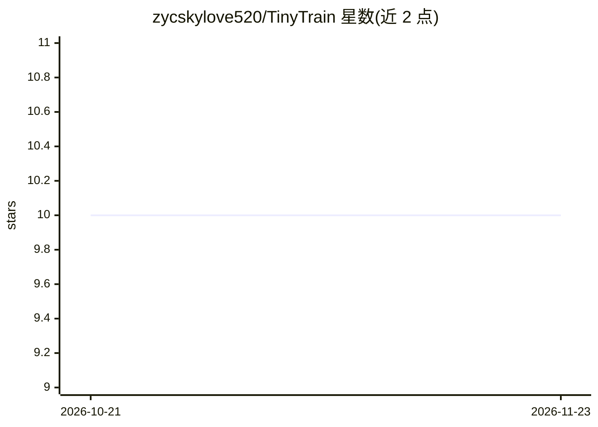

# zycskylove520/TinyTrain

⭐ 10 · Python · MIT · 推送 2026-01-28 · [GitHub](https://github.com/zycskylove520/TinyTrain) · 个人维护 · 中文 README

**面向研究者与工程师的 PyTorch 全流程深度学习框架**

基于 PyTorch 构建的配置驱动深度学习框架，覆盖训练、评估、可视化到模型导出的完整流程，预置 YOLO 系列（分类/检测/姿态/分割）、人脸识别与车牌识别模型。采用 TOML/YAML 统一配置并支持运行时参数覆盖，原生支持 DDP 分布式训练、混合精度与梯度累积，提供 Python 接口与命令行两种使用方式，支持 ONNX 运行时推理与多格式模型导出。

## 筛选速览

| 维度 | 判定 | 备注 |
|---|---|---|
| AI 角色 | `ai-native` | 本体是模型或模型工具 |
| 许可风险 | `permissive` | MIT |
| 部署形态 | `library` | 以包/库形式分发 |
| 模型依赖 | — | README 未给出锁定关系 |
| 硬件要求 | — | 无带数字的原话,不猜 |
| 安装摩擦 | `medium` | 含编译或系统依赖之一 |
| 成熟度 | — | 结构信号不足 |

## 能力要点

- 预置 YOLOv3–YOLOv12、人脸识别与车牌识别模型及标准训练流程
- 配置驱动：统一 TOML/YAML 管理并支持运行时动态覆盖
- 原生支持 DDP 分布式训练、混合精度、梯度累积
- 支持 ONNX 运行时推理与多格式模型导出

## 适用场景

- 快速启动目标检测/分类/姿态估计等视觉任务的训练项目
- 对 YOLO 系列模型做定制化训练与二次开发
- 将训练好的模型导出为 ONNX 等格式用于生产部署

## 场景标签

`目标检测` `人脸识别` `微调` · 领域:感知与多模态

## 证据(README 行号)

> L16: **TinyTrain** 是一个基于 PyTorch 构建的**生产级全栈深度学习框架**，致力于为研究者和工程师提供高效、灵活的中小型模型开发体验。通过高度模块化的架构设计，本框架显著降低了AI项目的工程复杂度，同时保持了科研
> L42: |YOLO系列|图像分类、目标检测、姿态估计、实例分割|YOLOv3、YOLOv5、YOLOv6、YOLOv8、YOLOv11、YOLOv12、Retinaface-YOLO|
> L90: `TinyTrain` 所有已实现的 AI 模型都在 `tinytrain.models` 模块中，提供统一的接口设计。

## 星数曲线

2026-10-21 10 → 2026-11-23 10（+0）

---
*卡片 v1 · prompt 1.4 · 生成 2026-11-19 · 置信度 high · 依据 README sha `911d2beed347` · [字段定义](../../DATASET.md)*
