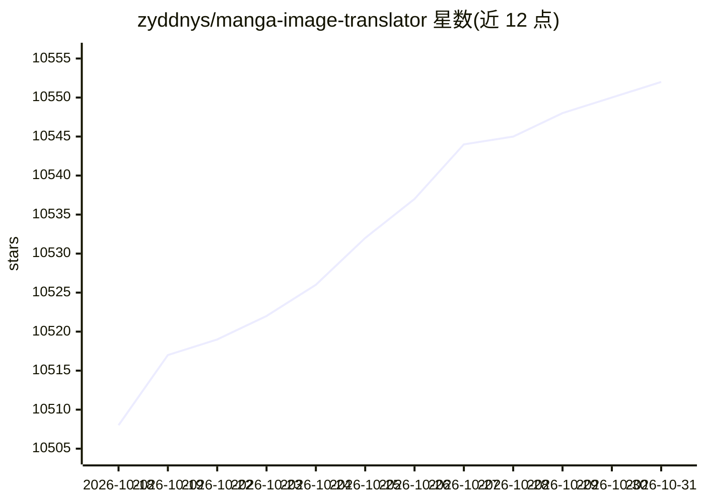

# zyddnys/manga-image-translator

⭐ 10,552 · Python · GPL-3.0 · 推送 2026-10-11 · [GitHub](https://github.com/zyddnys/manga-image-translator) · [官网](https://cotrans.touhou.ai/) · 个人维护 · 中文 README

**一键翻译漫画/图片内文字的工具：检测、OCR、翻译、修复、排版**

面向漫画及各类图片的文字翻译流水线：文本检测、OCR 识别、机器翻译、原图文字擦除（inpainting）、排版渲染，并支持上色（colorizer）。主要支持日语，另支持简繁中文、英语等 20 余种语言。以 Python 包/Docker 镜像提供，可运行本地批量模式、Web 服务、API 与 WebSocket 模式，模型运行时自动下载到 ./models。README 自述项目仍处于早期开发阶段。另有 Rust 编译版本与在线 demo 站点。

## 筛选速览

| 维度 | 判定 | 备注 |
|---|---|---|
| AI 角色 | `ai-native` | 本体是模型或模型工具 |
| 许可风险 | `viral` | GPL-3.0 |
| 部署形态 | `self-host` | docker 或自建部署 |
| 模型依赖 | local-ok | 支持本地模型 |
| 硬件要求 | — | 无带数字的原话,不猜 |
| 安装摩擦 | `low` | 无编译、无系统依赖或容器化 |
| 成熟度 | `idea` | |

## 能力要点

- 检测→OCR→翻译→修复→排版的完整图片翻译流水线
- 支持日语及简繁中文、英语等 20 余种语言
- 提供本地批量、Web、API、WebSocket 四种运行模式
- 支持 Docker 镜像（含模型，约 15GB）与 CPU/GPU 运行

## 适用场景

- 翻译群聊、图站等 unlikely 被专业翻译的漫画/图片
- 批量翻译本地图片文件夹并保留排版
- 以 API/Web 服务形式集成图片翻译能力

## 场景标签

`OCR` `图像视频处理` · 领域:感知与多模态

## 证据(README 行号)

> L9: > One-click translation of text in various images\
> L15: Supports image repair (text removal) and typesetting.
> L110: Models will be automatically downloaded to the `./models` directory at runtime.

## 星数曲线

2026-10-18 10,508 → 2026-10-31 10,552（+44）

---
*卡片 v1 · prompt 1.4 · 生成 2026-10-20 · 置信度 high · 依据 README sha `50864ae15c67` · [字段定义](../../DATASET.md)*
