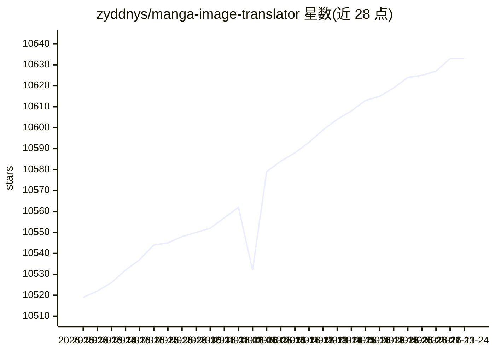

# zyddnys/manga-image-translator

⭐ 10,636 · Python · GPL-3.0 · 推送 2026-11-18 · [GitHub](https://github.com/zyddnys/manga-image-translator) · [官网](https://cotrans.touhou.ai/) · 个人维护 · 中文 README

**一键翻译漫画等各类图片内文字的工具**

面向难以获得专业翻译的图片（群聊、图板上的漫画/图像）的文字翻译工具： pipeline 包含文字检测、OCR、翻译、图像修复（去字）与排版渲染。主要支持日语，也支持简繁中文、英语等 20 余种小语种。提供本地批处理、Web 服务、API、WebSocket 多种运行模式，模型在运行时自动下载到 ./models 目录。安装方式为 pip/venv 或 Docker 镜像（约 15GB）；部分依赖需编译，Windows 需先装 C++ Build Tools；GPU 加速需安装对应 PyTorch/CUDA 版本。

## 筛选速览

| 维度 | 判定 | 备注 |
|---|---|---|
| AI 角色 | `ai-native` | 本体是模型或模型工具 |
| 许可风险 | `viral` | GPL-3.0 |
| 部署形态 | `self-host` | docker 或自建部署 |
| 模型依赖 | — | README 未给出锁定关系 |
| 硬件要求 | — | 无带数字的原话,不猜 |
| 安装摩擦 | `low` | 无编译、无系统依赖或容器化 |
| 成熟度 | `idea` | |

## 能力要点

- 检测+OCR+翻译+修复+排版的一体化图像翻译管线
- 支持本地批处理、Web、API、WebSocket 多种运行模式
- 提供在线演示站点与浏览器油猴脚本
- 模型运行时自动下载，Docker 镜像内置全部依赖与模型

## 适用场景

- 批量翻译无官方翻译的漫画图片
- 自建 Web/API 服务为图片提供翻译
- 翻译群聊或图板上的单张图像文字

## 场景标签

`图像视频处理` `OCR` · 领域:感知与多模态

## 证据(README 行号)

> L9: > One-click translation of text in various images\
> L13: This project aims to translate images that are unlikely to be professionally translated, such as comics/images on v
> L15: Supports image repair (text removal) and typesetting.

## 星数曲线

2026-10-22 10,519 → 2026-11-24 10,633（+114）

---
*卡片 v1 · prompt 1.4 · 生成 2026-11-22 · 置信度 high · 依据 README sha `2d986bfd6834` · [字段定义](../../DATASET.md)*
