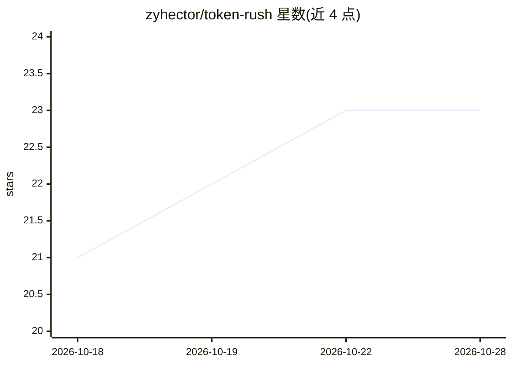

# zyhector/token-rush

⭐ 23 · Python · 推送 2026-09-12 · [GitHub](https://github.com/zyhector/token-rush) · 个人维护

**单卡 RTX 5090 上运行 Qwen3.8-27B 的单流 LLM 推理引擎**

面向单用户、单卡、单流场景的推理引擎，专为 Qwen3.8-27B 文本路径与 RTX 5090 (sm_120) 编写。采用 4.25 bit 分组 int4 量化（GPTQ+MSE 校准）、推测解码（MTP 头或 DFlash2 草稿模型）、CUDA graph 与自研 Triton/CUDA 内核，单流解码 229–379 tok/s。附带服务器模式，提供 OpenAI 与 Anthropic 兼容 API。限制：批大小固定为 1、仅此一模型一卡、纯文本（视觉塔已移除），上下文 256k 需约 30 GB 显存。

## 筛选速览

| 维度 | 判定 | 备注 |
|---|---|---|
| AI 角色 | `ai-ecosystem` | LLM/agent 周边工具 |
| 许可风险 | `none` | — |
| 部署形态 | `None` |  |
| 模型依赖 | — | README 未给出锁定关系 |
| 硬件要求 | — | 无带数字的原话,不猜 |
| 安装摩擦 | `medium` | 含编译或系统依赖之一 |
| 成熟度 | — | 结构信号不足 |

## 能力要点

- int4（4.25 bpw，128 组 GPTQ+MSE）量化与推测解码（MTP/DFlash2 草稿）
- 整解码步进 CUDA graph，含图内推测验证
- 提供服务端：OpenAI 与 Anthropic 兼容 API，Claude Code 可端到端运行
- 262k token 上下文针检索验证，65 个测试（pytest tests/）

## 适用场景

- 单张 RTX 5090 上以低延迟跑 Qwen3.8-27B 对话
- 本地部署兼容 OpenAI/Anthropic API 的推理服务
- 用 Claude Code 连接本地单卡模型工作

## 场景标签

 · 领域:LLM 推理/服务

## 证据(README 行号)

> L4:  The fastest inference engine for Qwen3.8-27B on one RTX 5090 — built for one user, one card, one stream.
> L23: It is a server too. `python -m tokenrush.serve` speaks the OpenAI and Anthropic APIs, keeps the conversation reside
> L117: |`tokenrush/`|the engine: `model.py` (the text path), `fused.py` / `ops.py` (Triton kernels), `csrc/` (the Marlin 

## 星数曲线

2026-10-18 21 → 2026-10-28 23（+2）

---
*卡片 v1 · prompt 1.4 · 生成 2026-10-27 · 置信度 high · 依据 README sha `d5a5372362eb` · [字段定义](../../DATASET.md)*
