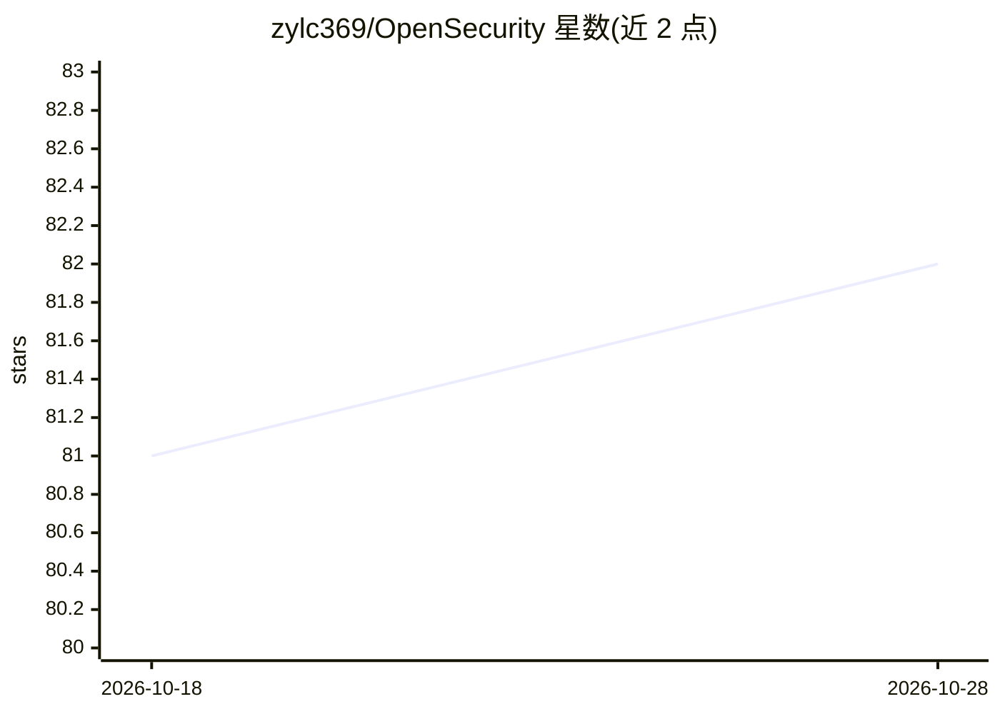

# zylc369/OpenSecurity

⭐ 82 · Python · Apache-2.0 · 推送 2026-10-19 · [GitHub](https://github.com/zylc369/OpenSecurity) · 个人维护 · 中文 README

**AI 驱动的多领域安全分析 Agent 平台，让 LLM 端到端完成逆向与安全审计**

构建于 OpenCode Agent 框架之上的安全分析平台，由 6 个 Agent 组成：一个复合任务协调器、二进制逆向、移动端逆向、Web 安全、AI 应用安全（提示注入/越狱）四个领域 Agent，以及从实战复盘中沉淀脚本与知识库的自我进化 Agent。LLM 编排 Python/Bash 工具脚本与 Markdown 知识库三层分离；IDA 操作走 idat headless + IDAPython 而非 GUI，保证过程可复现。运行依赖 OpenCode、Python 3.8+、IDA Pro（仅逆向类 Agent 需要）及 Frida、apktool 等外部工具，通过 git clone 安装。

## 筛选速览

| 维度 | 判定 | 备注 |
|---|---|---|
| AI 角色 | `ai-native` | 本体是模型或模型工具 |
| 许可风险 | `permissive` | Apache-2.0 |
| 部署形态 | `desktop` | 安装包/桌面程序 |
| 模型依赖 | — | README 未给出锁定关系 |
| 硬件要求 | — | 无带数字的原话,不猜 |
| 安装摩擦 | `medium` | 含编译或系统依赖之一 |
| 成熟度 | — | 结构信号不足 |

## 能力要点

- 6 个 Agent：协调器 + 二进制/移动/Web/AI 安全四领域 + 自我进化引擎
- 三层分离：Agent prompt 编排层、Python/Bash 工具层、按需加载知识库层
- IDA 走 headless 模式 + IDAPython，分析过程可稳定复现
- 中间产物（反编译输出、报告等）持久化到任务目录

## 适用场景

- 让 LLM 端到端逆向 crackme 等二进制并产出可验证报告
- 对 APK/IPA 做反编译与 Native/Java 分析
- 审计 Web 应用漏洞并构造攻击链
- 测试 LLM 应用的提示注入与越狱风险

## 场景标签

`网络安全` `多智能体` · 领域:Agent 开发

## 证据(README 行号)

> L11: OpenSecurity 让 LLM 端到端地完成一次安全分析：拿到目标文件，自己编排工具链（IDA Pro、Frida、apktool……），一步步推进，最后产出一份可验证的报告。不是问一句答一句，不是停在"我建议你用 IDA 
> L34: - **AI 编排层** — Agent prompt（何时调用什么工具、如何推理），由 LLM 执行

## 星数曲线

2026-10-18 81 → 2026-10-28 82（+1）

---
*卡片 v1 · prompt 1.4 · 生成 2026-10-24 · 置信度 high · 依据 README sha `7f4b8eb87a91` · [字段定义](../../DATASET.md)*
