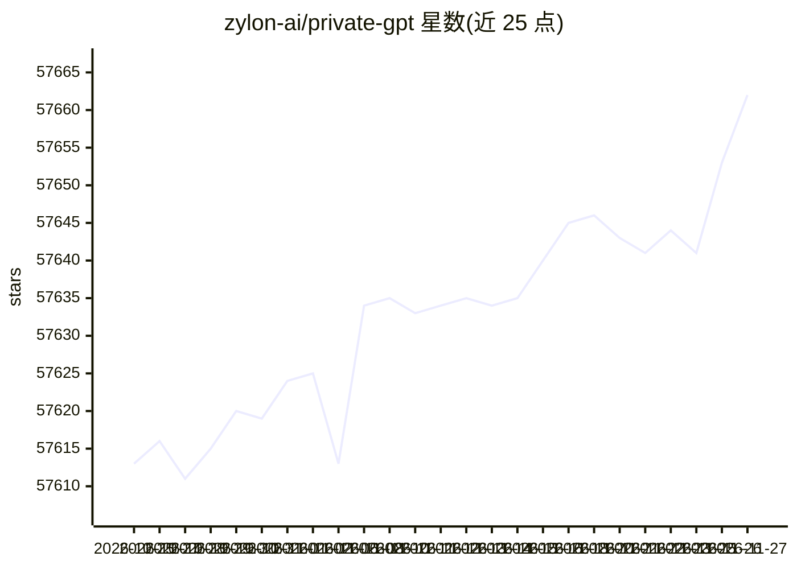

# zylon-ai/private-gpt

⭐ 57,662 · Python · Apache-2.0 · 推送 2026-11-26 · [GitHub](https://github.com/zylon-ai/private-gpt) · [官网](https://www.zylon.ai/private-gpt) · 组织维护

**本地模型的私有 AI 应用 API 层：RAG、工具与 MCP**

开源 API 层，将 OpenAI 兼容推理服务器（Ollama/llama.cpp/vLLM 等）暴露的本地模型封装为应用级 API，遵循 Claude API 规范：提供消息（流式/异步/token 计数）、文件摄取与带引用的检索、内置与自定义工具、MCP 连接器、数据库与 CSV 结构化访问、嵌入与编排。本产品自身不运行模型，需先启动一个实现 /v1/chat/completions 与 /v1/models 的推理服务器。附带 /ui 演示用工作台 UI，开发者在其 API 之上构建自有应用。

## 筛选速览

| 维度 | 判定 | 备注 |
|---|---|---|
| AI 角色 | `ai-ecosystem` | LLM/agent 周边工具 |
| 许可风险 | `permissive` | Apache-2.0 |
| 部署形态 | `None` |  |
| 模型依赖 | local-ok | 支持本地模型 |
| 硬件要求 | — | 无带数字的原话,不猜 |
| 安装摩擦 | `low` | 无编译、无系统依赖或容器化 |
| 成熟度 | `idea` | |

## 动量与使用信号

- 维护:`active` — 距上次 push 1.9 天,年发版 4,108 位贡献者
- 涨星:近 1 天 **+7**(自 20261016 起算)
- 平台:WINDOWS / MACOS / LINUX · 协议:OPENAI-API / MCP / OLLAMA

## 能力要点

- 遵循 Claude API 规范的本地模型 API 层（消息/工具/MCP/检索）
- 文件摄取、带引用的 agentic RAG 与数据库/CSV 内置查询
- 内置工具：web search、web fetch、代码执行，支持自定义工具与 MCP
- 附工作台 UI（模型选择/文档上传/API 调试器）用于测试与演示

## 适用场景

- 在私有部署环境为本地模型补齐 RAG、工具与文件摄取等应用层能力
- 把 Claude Desktop/Claude Code/n8n 等工具接到自己的本地模型后端
- 为不依赖云 API 的私有 AI 产品构建标准化后端 API

## 场景标签

`RAG` `模型网关` · 领域:Agent 开发

## 证据(README 行号)

> L3: **PrivateGPT is the open-source API layer that turns local models into production AI applications.**
> L12: Running a model locally is only the first step. To build useful AI applications you need a set of higher-level buil
> L24: > PrivateGPT does **not** run models itself. It connects to any OpenAI-compatible inference server via `OPENAI_API_

## 星数曲线

2026-10-25 57,613 → 2026-11-27 57,662（+49）

---
*卡片 v1 · prompt 1.4 · 生成 2026-11-22 · 置信度 high · 依据 README sha `13dca467ea86` · [字段定义](../../DATASET.md)*
