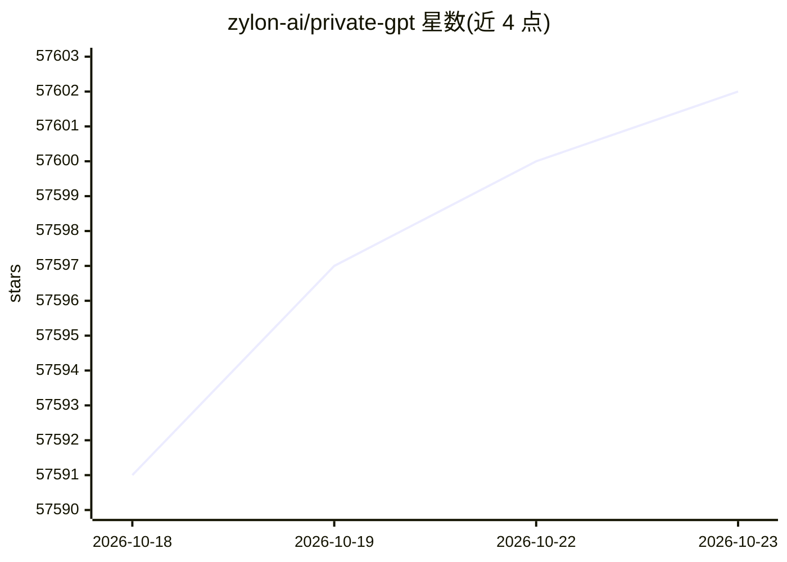

# zylon-ai/private-gpt

⭐ 57,602 · Python · Apache-2.0 · 推送 2026-10-20 · [GitHub](https://github.com/zylon-ai/private-gpt) · [官网](https://www.zylon.ai/private-gpt) · 组织维护

**把本地模型变成私有 AI 应用的开源 API 层**

以 Claude API 为参照模型的 API 层，为本地模型提供消息、文件摄取、带引用的检索与 agentic RAG、内置工具、MCP、数据库/CSV 访问、嵌入与编排等后端原语。自身不运行模型，通过 OPENAI_API_BASE 连接任意 OpenAI 兼容推理服务器。附内置演示 UI，API 为核心产品。2023 年以离线文档问答脚本起步，后重构为 1.0 API 层，由 Zylon 团队维护。

## 筛选速览

| 维度 | 判定 | 备注 |
|---|---|---|
| AI 角色 | `ai-native` | 本体是模型或模型工具 |
| 许可风险 | `permissive` | Apache-2.0 |
| 部署形态 | `None` |  |
| 模型依赖 | local-ok | 支持本地模型 |
| 硬件要求 | — | 无带数字的原话,不猜 |
| 安装摩擦 | `low` | 无编译、无系统依赖或容器化 |
| 成熟度 | `idea` | |

## 动量与使用信号

- 维护:`active` — 距上次 push 1.9 天,年发版 4,108 位贡献者
- 涨星:近 1 天 **+7**(自 20261016 起算)
- 平台:WINDOWS / MACOS / LINUX · 协议:OPENAI-API / MCP / OLLAMA

## 能力要点

- 兼容 Claude API 的消息流式、文件摄取、引用检索与工具调用
- 内置 web search/fetch、代码执行工具与 MCP 连接器
- 连接任意 OpenAI 兼容推理服务器（Ollama、llama.cpp、vLLM 等）
- 提供 brew/uv 安装与内置演示 UI

## 适用场景

- 在本地推理服务器之上搭建私有 AI 应用后端
- 为 Claude Code、Claude Desktop 等客户端接入本地模型
- 企业内网无云依赖的文档问答与检索场景
- 用 API 层为终端产品封装 RAG、数据库问答等能力

## 场景标签

`RAG` `文档问答` · 领域:知识与检索

## 证据(README 行号)

> L3: **PrivateGPT is the open-source API layer that turns local models into production AI applications.**
> L12: Running a model locally is only the first step. To build useful AI applications you need a set of higher-level buil
> L24: > PrivateGPT does **not** run models itself. It connects to any OpenAI-compatible inference server via `OPENAI_API_

## 星数曲线

2026-10-18 57,591 → 2026-10-23 57,602（+11）

---
*卡片 v1 · prompt 1.4 · 生成 2026-10-18 · 置信度 high · 依据 README sha `5c5e22cadea3` · [字段定义](../../DATASET.md)*
