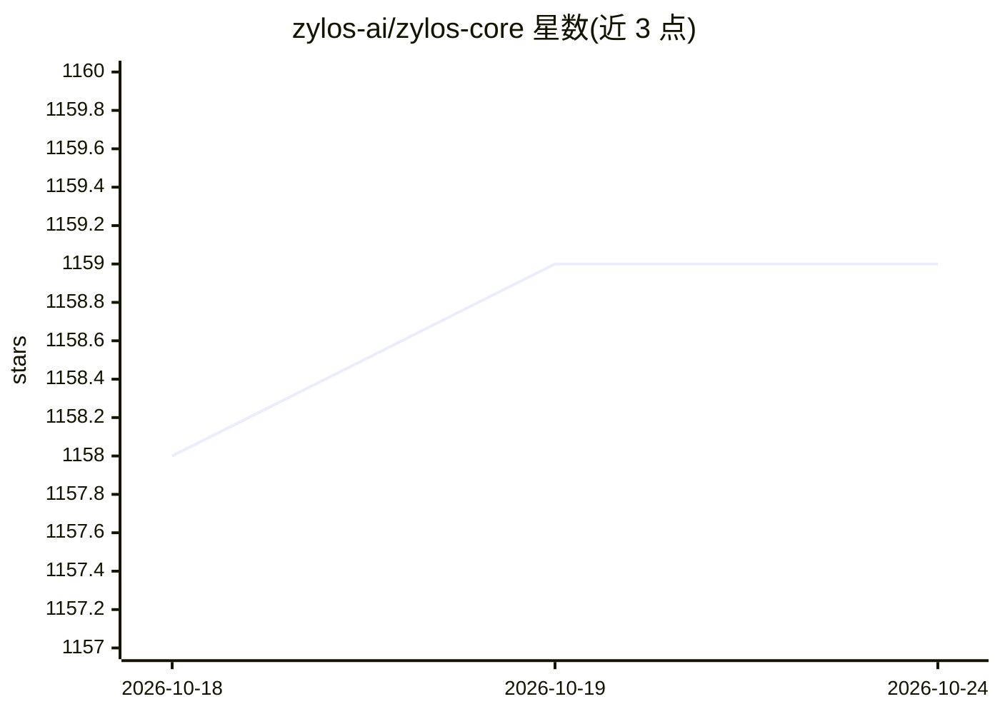

# zylos-ai/zylos-core

⭐ 1,159 · JavaScript · MIT · 推送 2026-10-23 · [GitHub](https://github.com/zylos-ai/zylos-core) · [官网](https://zylos.ai) · 组织维护 · 中文 README

**开源 AI agent 基础设施：为 Claude Code/Codex 提供持久运行与协作**

自托管的 agent 运行与管理基础设施：将 Claude Code（Anthropic）与 Codex（OpenAI）作为可互换的 AI 运行时托管在 Linux/macOS 服务器上，提供跨重启持久化的五层记忆（Inside Out）、基于 Cron 的自主任务调度、通过 Telegram/Lark/Web 控制台的统一通信桥（C4，SQLite 持久化）、崩溃恢复与心跳监控（PM2）、Caddy 反向代理与自动 HTTPS。通过安装脚本或 npm 安装，支持 Docker 部署，需 Node.js 20+ 与 Claude 订阅或 OpenAI API key。

## 筛选速览

| 维度 | 判定 | 备注 |
|---|---|---|
| AI 角色 | `ai-ecosystem` | LLM/agent 周边工具 |
| 许可风险 | `permissive` | MIT |
| 部署形态 | `self-host` | docker 或自建部署 |
| 模型依赖 | locked-api |  |
| 硬件要求 | — | 无带数字的原话,不猜 |
| 安装摩擦 | `low` | 无编译、无系统依赖或容器化 |
| 成熟度 | — | 结构信号不足 |

## 能力要点

- Claude Code 与 Codex 作为可互换运行时，切换时保留记忆与技能
- 五层 Inside Out 记忆架构，上下文压缩前自动保存
- C4 通信桥统一 Telegram/Lark/Web 控制台消息为单一会话与记忆
- 内置崩溃恢复、心跳探活、健康监控与自动升级（PM2）

## 适用场景

- 在自有服务器上 7x24 运行我的 AI agent 并保留长期记忆
- 让 AI 在我离开时按调度自主执行任务
- 通过 Telegram、飞书或网页控制台与同一个 AI 对话
- 用 Claude 订阅而非按 token 计费运行常驻 agent

## 场景标签

 · 领域:AI Agent 基础设施

## 证据(README 行号)

> L19: Zylos gives it a life. Memory that survives restarts. A scheduler that works while you sleep. Communication through
> L21: Supports Claude Code (Anthropic) and Codex (OpenAI). Fully compatible with the OpenClaw ecosystem.
> L221: Zylos supports Claude Code (Anthropic) and Codex (OpenAI) as interchangeable AI runtimes. Start with one, switch t

## 星数曲线

2026-10-18 1,158 → 2026-10-24 1,159（+1）

---
*卡片 v1 · prompt 1.4 · 生成 2026-10-21 · 置信度 high · 依据 README sha `6a651ff48dcb` · [字段定义](../../DATASET.md)*
