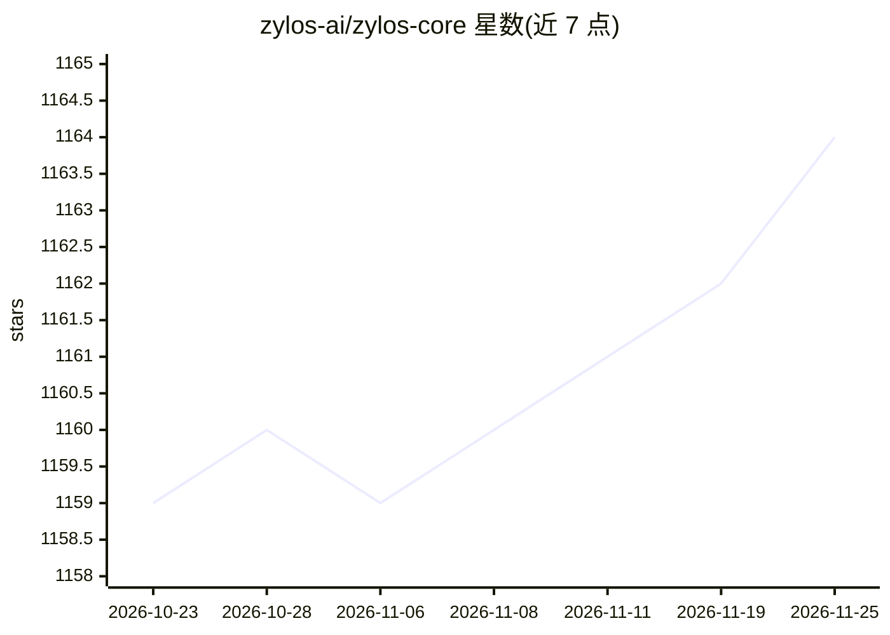

# zylos-ai/zylos-core

⭐ 1,164 · JavaScript · MIT · 推送 2026-11-23 · [GitHub](https://github.com/zylos-ai/zylos-core) · [官网](https://zylos.ai) · 组织维护 · 中文 README

**开源 agent 基础设施：为个人/团队 AI 提供记忆、调度与多渠道**

Zylos 是部署在自有 Linux/macOS 服务器上的 agent 运行基础设施：提供跨会话持久记忆（五层 Inside Out 架构）、定时任务调度器、崩溃恢复与心跳监控、Web 控制台及 Telegram/Lark 等通信渠道，所有消息经 C4 网关持久化到 SQLite。它以 Claude Code（Anthropic）或 Codex（OpenAI）作为可互换的 AI 运行时，依赖用户的 Claude 订阅按月固定成本运行。通过 curl 安装脚本、npm 手动安装或 Docker 部署，要求 Node.js 20+。由 OpenMax 构建，MIT 许可。

## 筛选速览

| 维度 | 判定 | 备注 |
|---|---|---|
| AI 角色 | `ai-ecosystem` | LLM/agent 周边工具 |
| 许可风险 | `permissive` | MIT |
| 部署形态 | `self-host` | docker 或自建部署 |
| 模型依赖 | locked-api |  |
| 硬件要求 | — | 无带数字的原话,不猜 |
| 安装摩擦 | `low` | 无编译、无系统依赖或容器化 |
| 成熟度 | — | 结构信号不足 |

## 能力要点

- 五层 Inside Out 记忆架构，上下文压缩前自动保存
- 内置崩溃恢复、心跳探活与自动升级，无需第三方监控
- Claude Code 与 Codex 双运行时可切换（zylos runtime codex）
- C4 统一消息网关，SQLite 持久化且可查询

## 适用场景

- 在自建服务器上运行 7×24 常驻个人 AI 助理
- 通过 Telegram/Lark/Web 与同一个有记忆的 AI 对话
- 让 AI 在夜间自主执行定时任务并自我修复故障
- 避免按 token 计费的高额常驻 agent 运行成本

## 场景标签

`AI 助手` `Agent 记忆` · 领域:Agent 开发

## 证据(README 行号)

> L19: Zylos gives it a life. Memory that survives restarts. A scheduler that works while you sleep. Communication through
> L21: Supports Claude Code (Anthropic) and Codex (OpenAI). Fully compatible with the OpenClaw ecosystem.
> L224: Zylos supports Claude Code (Anthropic) and Codex (OpenAI) as interchangeable AI runtimes. Start with one, switch t

## 星数曲线

2026-10-23 1,159 → 2026-11-25 1,164（+5）

---
*卡片 v1 · prompt 1.4 · 生成 2026-11-24 · 置信度 high · 依据 README sha `d43401be31cf` · [字段定义](../../DATASET.md)*
