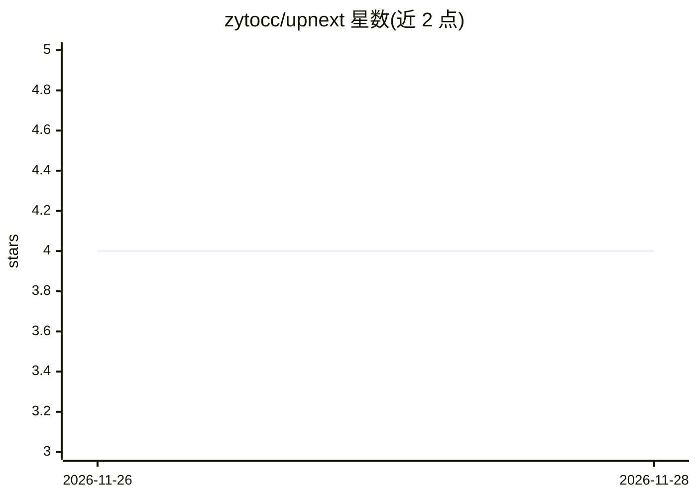

# zytocc/upnext

⭐ 4 · Rust · Apache-2.0 · 推送 2026-11-24 · [GitHub](https://github.com/zytocc/upnext) · [官网](https://upnext.games) · 个人维护

**读取你已有的游戏库，按心情推荐今晚玩什么**

UpNext 从 Steam、Epic、GOG、Amazon、EA、育碧、Xbox 等商店读取本地已拥有的游戏，合并为一份列表，并查询每款游戏的类型、时长、评分与玩家评价。用户以自然语言描述心情与时长后，它从库中挑选几款并给出理由。推荐来源可由用户选择：Claude/ChatGPT 订阅、API key、本地模型，或在无 AI 情况下由内置排序自行排名。全部运行在本地计算机上，数据存本地数据库，无账号、无遥测。提供 Windows 安装包、Linux 脚本、Flatpak、容器镜像与 Android 客户端。

## 筛选速览

| 维度 | 判定 | 备注 |
|---|---|---|
| AI 角色 | `ai-native` | 本体是模型或模型工具 |
| 许可风险 | `permissive` | Apache-2.0 |
| 部署形态 | `self-host` | docker 或自建部署 |
| 模型依赖 | — | README 未给出锁定关系 |
| 硬件要求 | — | 无带数字的原话,不猜 |
| 安装摩擦 | `low` | 无编译、无系统依赖或容器化 |
| 成熟度 | — | 结构信号不足 |

## 能力要点

- 读取 7 家商店/启动器的游戏库并合并去重
- 推荐引擎可选 Claude/ChatGPT 订阅、API key、本地模型，或无 AI 的内置排序
- 可读可编辑的口味画像，含喜好来源标注
- 提供 Web UI、大屏手柄模式、命令行与 Android 应用

## 适用场景

- 在已购买但未玩的游戏堆里挑今晚玩什么
- 按时长、心情等约束筛选合适的游戏
- 在家庭服务器/NAS 上自托管，全家多端访问

## 场景标签

 · 领域:游戏/消费级工具

## 证据(README 行号)

> L17: 3. You say what you're in the mood for, such as "about an hour, something calm with a bit of story". It suggests a 
> L19: The suggestions come from an AI you choose: your Claude or ChatGPT subscription, an API key, or a model on your own

## 星数曲线

2026-11-26 4 → 2026-11-28 4（+0）

---
*卡片 v1 · prompt 1.4 · 生成 2026-11-26 · 置信度 high · 依据 README sha `c3845767da15` · [字段定义](../../DATASET.md)*
