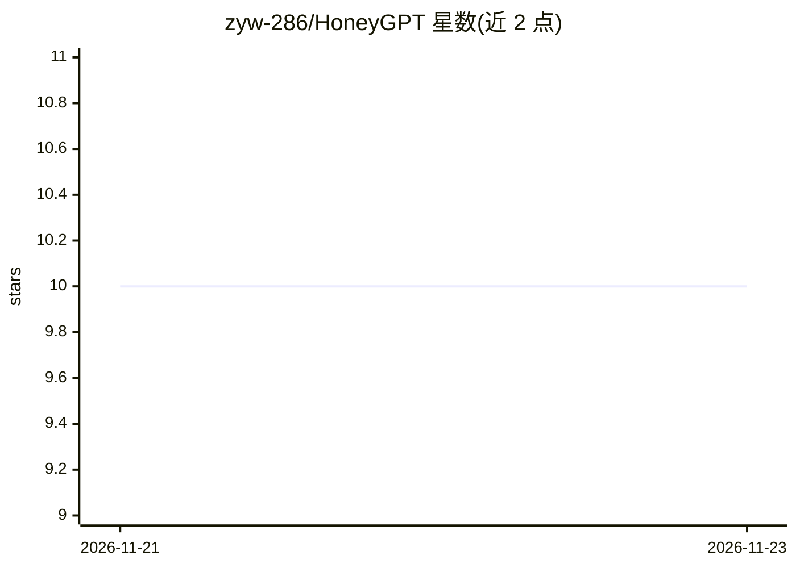

# zyw-286/HoneyGPT

⭐ 10 · JavaScript · NOASSERTION · 推送 2026-06-11 · [GitHub](https://github.com/zyw-286/HoneyGPT) · [官网](https://doi.org/10.1016/j.comnet.2026.112223) · 个人维护

**给安全研究人员提供 LLM 驱动的 SSH/Telnet 蜜罐**

基于 Cowrie 扩展的 SSH/Telnet 蜜罐：Terminal Protocol Proxy 复用 Cowrie 协议处理，Prompt Manager 将攻击者命令转为结构化提示，由 OpenAI 兼容模型实时生成贴合攻击意图的终端输出。机制包括 Question Enhancement（输出/状态变化/影响分三段分解）与 Memory Pruning（历史衰减剪枝、系统状态寄存器保持长会话一致），并采用混合仿真/LLM 策略降低成本与延迟。交互以 JSON 日志记录意图与状态，供 ATT&CK 风格威胁分析；以 Docker 容器部署，需要 OpenAI API key。

## 筛选速览

| 维度 | 判定 | 备注 |
|---|---|---|
| AI 角色 | `ai-native` | 本体是模型或模型工具 |
| 许可风险 | `permissive` | NOASSERTION |
| 部署形态 | `self-host` | docker 或自建部署 |
| 模型依赖 | — | README 未给出锁定关系 |
| 硬件要求 | — | 无带数字的原话,不猜 |
| 安装摩擦 | `low` | 无编译、无系统依赖或容器化 |
| 成熟度 | `idea` | |

## 能力要点

- 实时意图分析：每条命令生成输出、状态变化与 impact score 并写入 JSON 日志
- Memory Pruning + 系统状态寄存器维持多步长会话一致性
- 混合仿真/LLM 策略：简单命令缓存或仿真，仅新序列调用模型
- 附 1,489 轮 ATT&CK 标注欺骗评估测试集与评估脚本

## 适用场景

- 部署低交互蜜罐以延长攻击者会话、采集更丰富的攻击痕迹
- 对捕获的交互日志做 ATT&CK 风格威胁情报分析
- 用 Shell Attack Evolution 数据集评测其他蜜罐的欺骗效果

## 场景标签

`网络安全` `模型评测` · 领域:评测与运维

## 证据(README 行号)

> L25: HoneyGPT reframes terminal interaction as an **LLM-driven question–answer process** while keeping Cowrie as the pro
> L61: - **Prompt Manager** — converts each command into a structured prompt, parses the model response, and maintains hon
> L62: - **OpenAI-compatible model** — generates terminal output and state-analysis results from the prompt.

## 星数曲线

2026-11-21 10 → 2026-11-23 10（+0）

---
*卡片 v1 · prompt 1.4 · 生成 2026-11-21 · 置信度 high · 依据 README sha `f4d85f49090a` · [字段定义](../../DATASET.md)*
