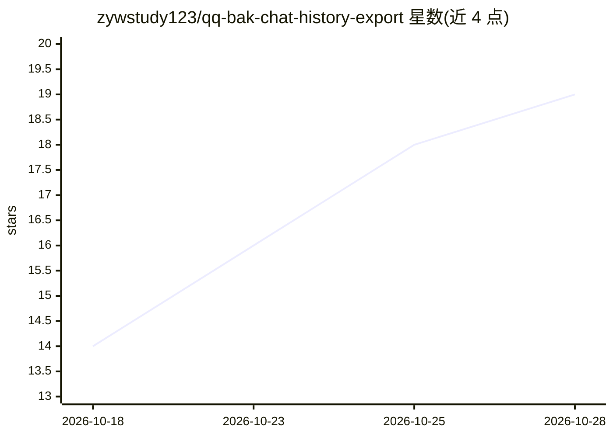

# zywstudy123/qq-bak-chat-history-export

⭐ 19 · Python · MIT · 推送 2026-08-26 · [GitHub](https://github.com/zywstudy123/qq-bak-chat-history-export) · 个人维护 · 中文 README

**把 QQ/NTQQ 聊天记录导出为 Agent 可读的 TXT/JSON/CSV 工具**

Python 脚本工具，将 QQ 旧版 .bak 备份（经 QQ 官方导入后）或已解密的 NTQQ 本地数据库 nt_msg.db 导出为 TXT、JSON、CSV 等文件，支持群聊/私聊、日期过滤、关键词命中、导入前后新增消息对比，并提供每日统计与摘要。附带可安装为 Codex Skill 的形态，让本地 agent 自动执行导出流程。全程本地读写，需先用本地工具把加密的 NTQQ 数据库解密为普通 SQLite；提供合成测试数据供无真实账号时验证。

## 筛选速览

| 维度 | 判定 | 备注 |
|---|---|---|
| AI 角色 | `ai-enhanced` | 去掉 AI 部分产品仍成立 |
| 许可风险 | `permissive` | MIT |
| 部署形态 | `None` |  |
| 模型依赖 | — | README 未给出锁定关系 |
| 硬件要求 | — | 无带数字的原话,不猜 |
| 安装摩擦 | `low` | 无编译、无系统依赖或容器化 |
| 成熟度 | — | 结构信号不足 |

## 能力要点

- 读取 NTQQ nt_msg.db 并导出 TXT/JSON/CSV/统计文件
- 支持日期过滤、关键词命中、导入前后新增消息对比
- 可安装为 Codex Skill，由本地 agent 调用执行
- 提供合成测试数据，无真实账号/数据库即可验证

## 适用场景

- 把只能 在 QQ 内查看的聊天记录导出为通用文件
- 为 AI agent 准备可读取的聊天记录文本与结构化 JSON
- 用关键词和日期筛选重点消息

## 场景标签

`文档解析` · 领域:知识与检索

## 证据(README 行号)

> L3: **QQ聊天记录， bak文件解码导出工具 — 将 QQ / NTQQ 聊天记录转换为 Agent 可读的 TXT、JSON、CSV**
> L142: 本仓库同时提供可安装的 Codex Skill。安装后可以让本地 agent 自动执行 QQ bak 聊天记录导出流程。

## 星数曲线

2026-10-18 14 → 2026-10-28 19（+5）

---
*卡片 v1 · prompt 1.4 · 生成 2026-10-28 · 置信度 mid · 依据 README sha `a51645a955e5` · [字段定义](../../DATASET.md)*
