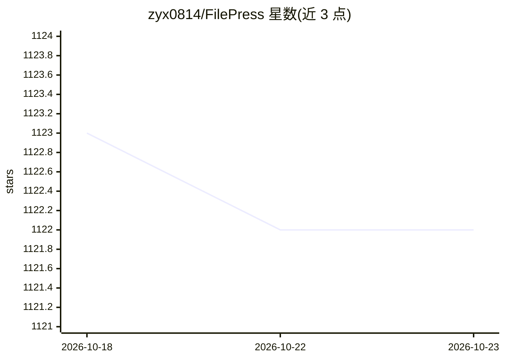

# zyx0814/FilePress

⭐ 1,122 · PHP · 推送 2026-09-02 · [GitHub](https://github.com/zyx0814/FilePress) · [官网](https://filepress.cn) · 个人维护 · 中文 README

**文件驱动型建站系统：网盘管理与文件发布网站，带 AI 标注**

基于 PHP + MySQL 的文件驱动型建站系统，以文件组织与发布为中心，提供多视图列表、大缩略图快速预览、标签化文件管理、自定义封面与多预览图、多库管理等网盘功能。支持整库共享、拖拽搭建展示单页、以及将共享文件组织成完整网站。AI 为辅助功能：通过自定义 Prompt 调用大模型实现文件改名、打标签、写描述、批量标注与文件问答，目前 AI 仅支持图片文件类型；文档、视频支持仍在计划中。后台为无代码配置界面，前台负责日常管理。

## 筛选速览

| 维度 | 判定 | 备注 |
|---|---|---|
| AI 角色 | `ai-enhanced` | 去掉 AI 部分产品仍成立 |
| 许可风险 | `none` | — |
| 部署形态 | `None` |  |
| 模型依赖 | — | README 未给出锁定关系 |
| 硬件要求 | — | 无带数字的原话,不猜 |
| 安装摩擦 | `low` | 无编译、无系统依赖或容器化 |
| 成熟度 | — | 结构信号不足 |

## 能力要点

- 多种列表模式与大缩略图列表内直接预览音视频
- 多库管理、自定义封面、多预览图与二级标签/描述/评分
- 整库共享、拖拽单页与组织成完整文件发布网站
- 自定义 Prompt 驱动的 AI 改名/打标签/写描述/批量标注/文件问答（当前仅支持图片）

## 适用场景

- 把网盘文件整理并发布为团队或企业的资料共享网站
- 为设计、电商、游戏等素材建立共享库与展示平台
- 用 AI 批量为图片文件生成名称、标签与描述
- 搭建个人家庭媒体资料库或企业知识库

## 场景标签

 · 领域:云存储/建站工具

## 证据(README 行号)

> L4: FilePress是一款全新的文件驱动型建站系统，它突破了传统 CMS 以“文章 + 附件”为中心的架构，重新定义了文件内容的组织与发布方式。
> L68: 文件的分类和标注一直是文件管理中的挑战，需要管理人员投入大量时间和精力。幸运的是，如今AI大模型的出现为这项工作提供了解决方案。FilePress 将全面整合AI智能功能，以提升文件管理效率。目前，FilePress 已经实现了以

## 星数曲线

2026-10-18 1,123 → 2026-10-23 1,122（-1）

---
*卡片 v1 · prompt 1.4 · 生成 2026-10-21 · 置信度 high · 依据 README sha `376c80ab2e8d` · [字段定义](../../DATASET.md)*
