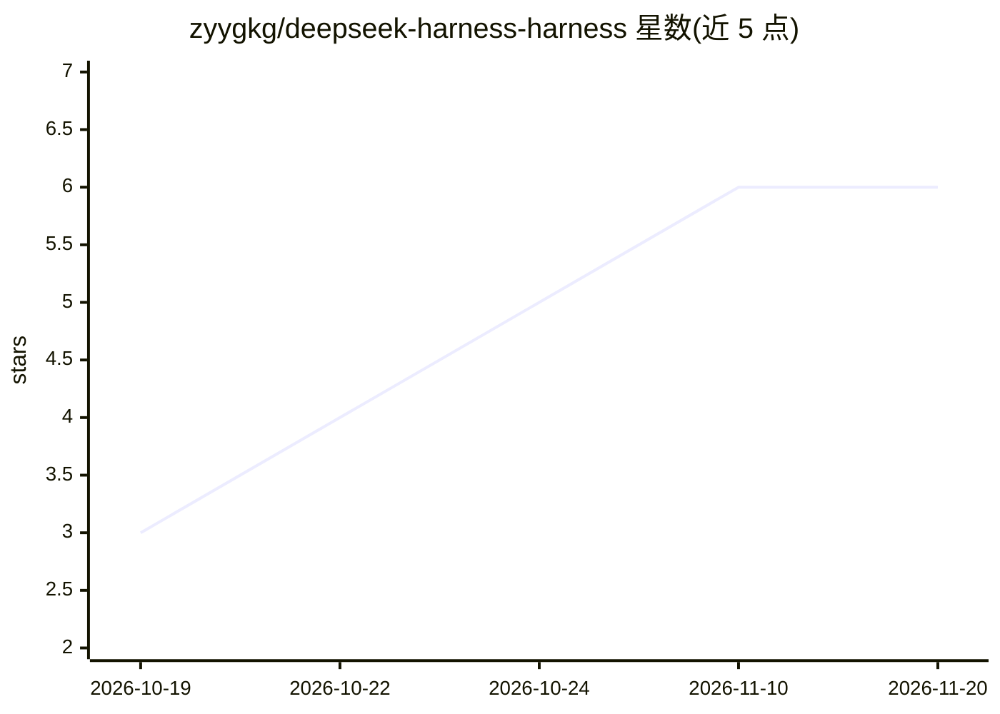

# zyygkg/deepseek-harness-harness

⭐ 6 · JavaScript · MIT · 推送 2026-10-16 · [GitHub](https://github.com/zyygkg/deepseek-harness-harness) · 个人维护 · 中文 README

**DSH agent 插件：经已登录浏览器调用免费网页版 DeepSeek，无需 API key**

DeepSeek Harness（DSH）的插件，注册单一工具 web_deepseek_solve：把用户要求套入可覆盖的提示词模板，通过 BrowserSkill 的 bsk CLI + daemon 驱动本机已登录 chat.deepseek.com 的浏览器，完成发送、流式完成检测（DOM 轮询 + 文本稳定判定）与回复全文提取，返回给 agent 执行。唯一运行时依赖是 bsk CLI/daemon 与浏览器登录态；单会话串行，依赖网页版 DOM 选择器，改版或风控需人工处理。支持 npm 包或 GitHub clone 本地两种安装方式，已在 DSH 0.2.0-rc.2 验证。

## 筛选速览

| 维度 | 判定 | 备注 |
|---|---|---|
| AI 角色 | `ai-ecosystem` | LLM/agent 周边工具 |
| 许可风险 | `permissive` | MIT |
| 部署形态 | `desktop` | 安装包/桌面程序 |
| 模型依赖 | locked-api |  |
| 硬件要求 | — | 无带数字的原话,不猜 |
| 安装摩擦 | `low` | 无编译、无系统依赖或容器化 |
| 成熟度 | — | 结构信号不足 |

## 能力要点

- web_deepseek_solve 工具：发送要求并提取网页版 DeepSeek 回复全文
- 无需 API key，复用本机浏览器登录态
- 可配置提示词模板、完成检测轮询参数与超时
- 支持深度思考开关与会话复用配置

## 适用场景

- 让 DSH agent 无需付费 API 即可调用网页版 DeepSeek 解题
- 在无 API 配额环境下为 agent 提供模型输出来源
- 将浏览器自动化作为 agent 与网页对话的桥接通道

## 场景标签

`浏览器自动化` · 领域:效率与自动化

## 证据(README 行号)

> L12: 把用户原始要求交给免费网页版 DeepSeek 求解，再返回给 DSH agent 执行 —— **无需 API key**。
> L53: 本插件的唯一运行时依赖是 **BrowserSkill 的 bsk CLI + daemon**（通过 `node:child_process` 调用），
> L74: 4. DSH 版本：已在 **0.2.0-rc.2（desktop profile）** 验证。插件手写标准 JSON Schema 注册工具，

## 星数曲线

2026-10-19 3 → 2026-11-20 6（+3）

---
*卡片 v1 · prompt 1.4 · 生成 2026-11-20 · 置信度 high · 依据 README sha `e2d98ee45d1c` · [字段定义](../../DATASET.md)*
