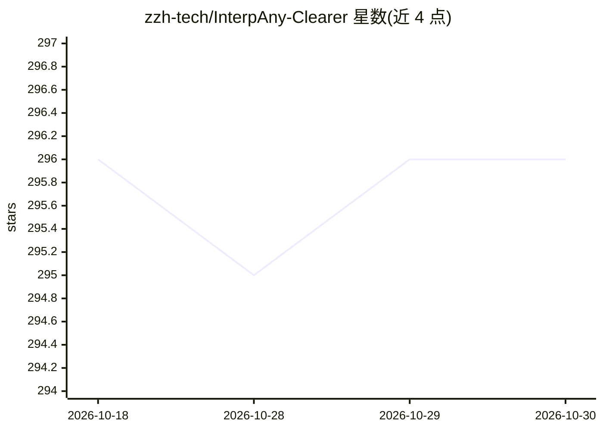

# zzh-tech/InterpAny-Clearer

⭐ 296 · Python · MIT · 推送 2026-06-02 · [GitHub](https://github.com/zzh-tech/InterpAny-Clearer) · [官网](https://zzh-tech.github.io/InterpAny-Clearer/) · 个人维护 · 中文 README

**任意时刻清晰视频帧插值研究代码：距离索引解决速度歧义**

ECCV2024 Oral / TPAMI 论文的官方实现：针对视频帧插值中的速度歧义问题，提出距离索引（Distance Indexing）与基于参考的迭代估计策略，可对任意时刻插值出更清晰的中间帧，并支持对指定对象的操控式插值。提供 RIFE、IFRNet、AMT-S、EMA-VFI 四种模型的检查点，含两图/视频推理脚本、Vimeo90K 数据集处理、训练与测试命令，另带基于 Segment Anything 的本地 Web 应用。由上海AI Lab、Snap Inc. 等机构研究者维护，曾用于 CCTV5 慢动作演示。

## 筛选速览

| 维度 | 判定 | 备注 |
|---|---|---|
| AI 角色 | `ai-native` | 本体是模型或模型工具 |
| 许可风险 | `permissive` | MIT |
| 部署形态 | `library` | 以包/库形式分发 |
| 模型依赖 | — | README 未给出锁定关系 |
| 硬件要求 | — | 无带数字的原话,不猜 |
| 安装摩擦 | `medium` | 含编译或系统依赖之一 |
| 成熟度 | — | 结构信号不足 |

## 能力要点

- 距离索引与迭代参考估计解决速度歧义，支持任意时刻插值
- 提供 RIFE/IFRNet/AMT-S/EMA-VFI 四种模型检查点
- 集成 Segment Anything 的对象级操控插值 Web 应用
- 提供数据集处理、训练与测试完整流程脚本

## 适用场景

- 给视频生成更清晰的高倍率慢动作帧
- 研究者在 Vimeo90K 上复现或训练插值模型
- 对视频中指定对象做操控式插值实验

## 场景标签

`视频生成` `图像视频处理` · 领域:内容生成

## 证据(README 行号)

> L58: We addressed velocity ambiguity in video frame interpolation through innovative distance indexing and iterative
> L109: python inference_img.py --img0 [IMG_0] --img1 [IMG_1] --output_dir [OUTPUT_DIR] --model [MODEL_NAME] --variant [VA

## 星数曲线

2026-10-18 296 → 2026-10-30 296（+0）

---
*卡片 v1 · prompt 1.4 · 生成 2026-10-21 · 置信度 mid · 依据 README sha `f75ed139de53` · [字段定义](../../DATASET.md)*
