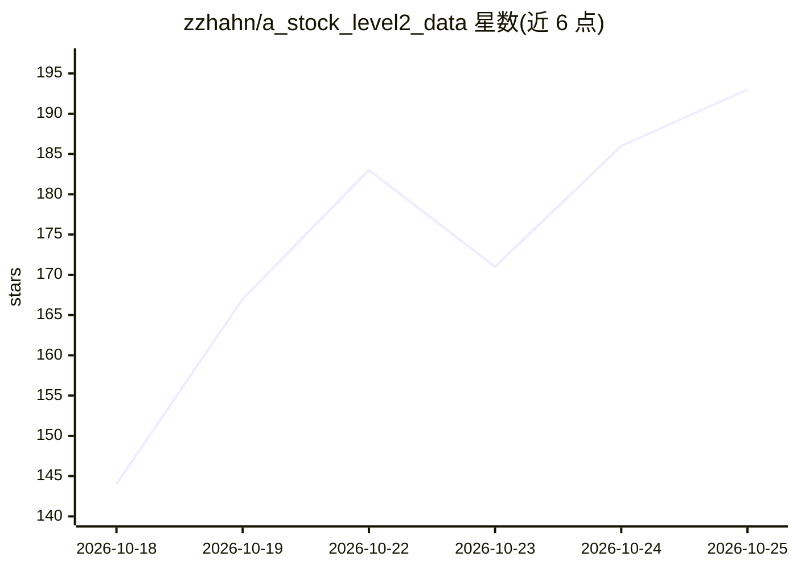

# zzhahn/a_stock_level2_data

⭐ 202 · 推送 2026-10-09 · [GitHub](https://github.com/zzhahn/a_stock_level2_data) · [官网](https://datas.lovestoblog.com/) · 个人维护 · 中文 README

**A股 Level-2 实时行情数据客户端：免开户取逐笔与十档盘口数据**

达塔接口是面向 A股市场的实时行情数据客户端：在本机运行数据服务，程序通过标准 HTTP 与 WebSocket 接口读取逐笔成交、逐笔委托、十档盘口、K线、资金流向、龙虎榜等 203 个字段的数据，支持全市场一次订阅、游标增量与断线续传。面向量化研究者、个人开发者与 AI Agent 自动化取数场景，提供 Windows/macOS/Linux 安装包及无界面服务器版本。需在官网注册登录并授权激活，可访问外网；不含交易下单功能。

## 筛选速览

| 维度 | 判定 | 备注 |
|---|---|---|
| AI 角色 | `ai-enhanced` | 去掉 AI 部分产品仍成立 |
| 许可风险 | `none` | — |
| 部署形态 | `None` |  |
| 模型依赖 | — | README 未给出锁定关系 |
| 硬件要求 | — | 无带数字的原话,不猜 |
| 安装摩擦 | `low` | 无编译、无系统依赖或容器化 |
| 成熟度 | — | 结构信号不足 |

## 能力要点

- 本机 HTTP/WebSocket 接口提供 203 个字段，含逐笔成交、逐笔委托、十档盘口
- 单条命令订阅 A股全市场约 6000 只，游标增量下发与断线续传
- 无界面服务器版本支持环境变量注入自动登录、激活与取数
- 示例脚本仅依赖 Python 标准库，支持任意可发请求的编程语言

## 适用场景

- 把逐笔、盘口、资金数据接入自己的回测或因子流水线
- 给盯盘工具、选股脚本接一个行情数据源
- 让 AI Agent 在服务器上自动登录、启动客户端并取数

## 场景标签

`金融量化` · 领域:学习与行业

## 证据(README 行号)

> L3: > **达塔接口是一个面向 A股市场的实时行情数据客户端**，提供 A股实时行情接口、
> L35: |AI Agent / 自动化|让程序自动登录、启动、取数，不需要人工点界面|

## 星数曲线

2026-10-18 144 → 2026-10-25 193（+49）

---
*卡片 v1 · prompt 1.4 · 生成 2026-10-22 · 置信度 high · 依据 README sha `29808e6590bb` · [字段定义](../../DATASET.md)*
