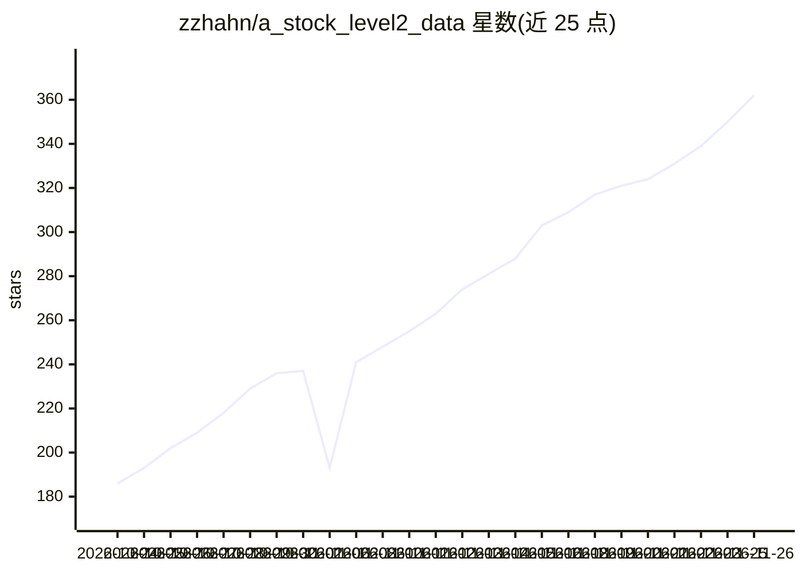

# zzhahn/a_stock_level2_data

⭐ 362 · 推送 2026-11-02 · [GitHub](https://github.com/zzhahn/a_stock_level2_data) · [官网](https://datas.lovestoblog.com/) · 个人维护 · 中文 README

**给量化研究者与 AI Agent 提供 A股 Level-2 实时行情的客户端**

面向 A股市场的行情数据客户端，将逐笔成交、逐笔委托、十档盘口、K线、资金流向、龙虎榜等数据通过本机 HTTP/WebSocket 接口提供给用户程序，覆盖全市场约 6000 只标的，支持游标增量下发与断线续传。客户端需登录并授权激活，无证券账户与资产门槛要求，但不含交易下单功能。提供 Windows/macOS/Linux 安装包，含无需桌面环境的无界面运行方式；示例脚本仅依赖 Python 标准库。

## 筛选速览

| 维度 | 判定 | 备注 |
|---|---|---|
| AI 角色 | `ai-enhanced` | 去掉 AI 部分产品仍成立 |
| 许可风险 | `none` | — |
| 部署形态 | `None` |  |
| 模型依赖 | — | README 未给出锁定关系 |
| 硬件要求 | — | 无带数字的原话,不猜 |
| 安装摩擦 | `low` | 无编译、无系统依赖或容器化 |
| 成熟度 | — | 结构信号不足 |

## 能力要点

- 单次订阅覆盖全市场约 6000 只，203 个行情字段，单次最多请求 255 个
- 本机 HTTP/WebSocket 接口，标准协议可被任意语言调用
- 游标增量下发，断线后可续取
- 提供 ai_control.py 示例脚本支持无界面环境自动登录与取数

## 适用场景

- 把逐笔与盘口数据接入回测或因子流水线
- 服务器无界面环境下让程序自动登录取数
- 给盯盘工具或选股脚本接一个行情源

## 场景标签

`金融量化` · 领域:学习与行业

## 证据(README 行号)

> L3: > **达塔接口是一个面向 A股市场的实时行情数据客户端**，提供 A股实时行情接口、
> L6: > 盯盘工具、策略回测和 AI Agent 取数。
> L35: |AI Agent / 自动化|让程序自动登录、启动、取数，不需要人工点界面|

## 星数曲线

2026-10-24 186 → 2026-11-26 362（+176）

---
*卡片 v1 · prompt 1.4 · 生成 2026-11-25 · 置信度 high · 依据 README sha `8a4236209739` · [字段定义](../../DATASET.md)*
