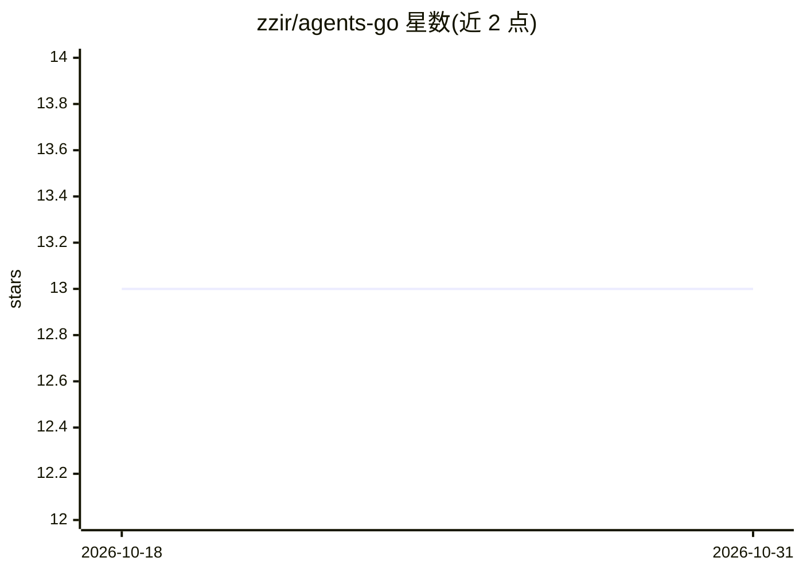

# zzir/agents-go

⭐ 13 · Go · MIT · 推送 2026-10-25 · [GitHub](https://github.com/zzir/agents-go) · 个人维护

**本地单二进制的多 agent 开发工作台：查看、重放、分叉 agent 会话**

Go 语言实现的 agent 工作台与 agents 运行时包：下载单个二进制 agents-server 即可本地运行，无需账号与 Docker，使用用户自备的模型 provider key。提供会话树 Transcript、查看模型实际收到的 Context、带 token 与延迟的 Traces、可改提示词/模型重放并 diff 的 Replay、任意回合分叉的 Fork，以及逐次工具调用审批机制。支持 MCP 服务器、Agent Skills、可选 Docker/E2B 沙箱与团队模式。底层 agents 包可通过 go get 嵌入自研程序，API 处于 pre-1.0。

## 筛选速览

| 维度 | 判定 | 备注 |
|---|---|---|
| AI 角色 | `ai-ecosystem` | LLM/agent 周边工具 |
| 许可风险 | `permissive` | MIT |
| 部署形态 | `None` |  |
| 模型依赖 | — | README 未给出锁定关系 |
| 硬件要求 | — | 无带数字的原话,不猜 |
| 安装摩擦 | `low` | 无编译、无系统依赖或容器化 |
| 成熟度 | `idea` | |

## 能力要点

- 单二进制本地运行，自备 provider key，无需 Docker
- Traces 展示模型/工具/handoff/guardrail 各 span 的 token、延迟与错误
- Replay 可换提示词/模型/工具重跑并 diff，Fork 可在任意回合分支会话
- 逐 agent 粒度的工具调用审批策略；agents Go 包可嵌入自研程序

## 适用场景

- 调试 agent 运行：查看模型实际收到的上下文与每步调用开销
- 改提示词或模型重放某次生成并对比结果
- 按需分叉会话做分支实验，父会话保留

## 场景标签

`多智能体` `Agent 框架` `LLM 可观测性` · 领域:Agent 开发

## 证据(README 行号)

> L3: **Agent went wrong? See what the model saw, replay it, fork it.**
> L55: The workbench is a Go program on top of the `agents` package; anything it does, your own program can do. Nothing ab
> L42: - **Traces**: model, tool, handoff and guardrail spans with tokens, latency and errors. No backend to run.

## 星数曲线

2026-10-18 13 → 2026-10-31 13（+0）

---
*卡片 v1 · prompt 1.4 · 生成 2026-10-31 · 置信度 high · 依据 README sha `8194e8f2e02a` · [字段定义](../../DATASET.md)*
