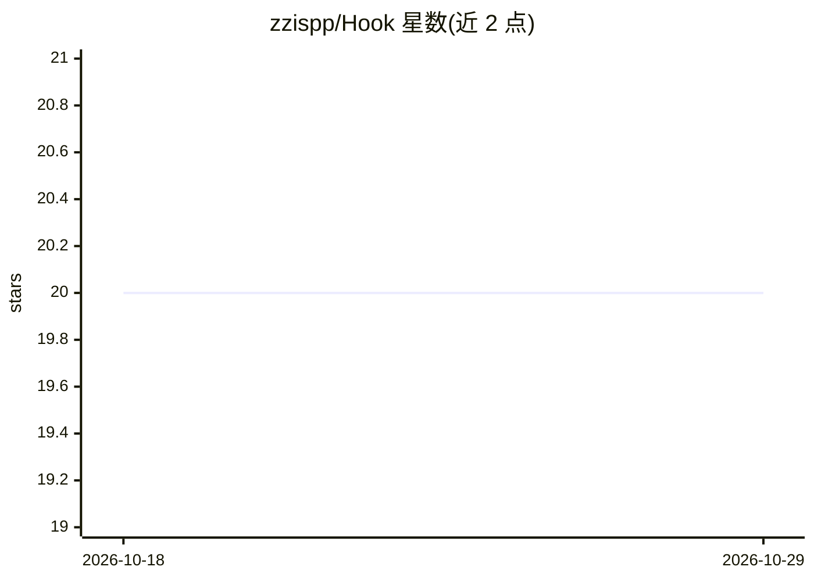

# zzispp/Hook

⭐ 20 · Rust · MIT · 推送 2026-08-10 · [GitHub](https://github.com/zzispp/Hook) · [官网](https://zzispp.github.io/Hook) · 个人维护 · 中文 README

**AI API 网关与运营平台：统一模型路由、计费与权限管理**

Rust + Next.js monorepo 实现的 AI API 网关：后端用 Axum/SeaORM/Redis/PostgreSQL，代理 OpenAI 风格 /v1 与 Gemini 风格 /v1beta 路由（chat、Claude Messages、embeddings、rerank、Realtime 等），按模型、provider、余额与权限策略路由请求，并记录用量与计费。提供用户令牌、RBAC、钱包计费、充值卡密与分销、请求记录与成本分析、模型状态监控及运营后台。部署支持 Docker Compose 预构建镜像、源码构建、二进制包与无 Docker 源码运行，需外部 PostgreSQL 与 Redis。

## 筛选速览

| 维度 | 判定 | 备注 |
|---|---|---|
| AI 角色 | `ai-ecosystem` | LLM/agent 周边工具 |
| 许可风险 | `permissive` | MIT |
| 部署形态 | `self-host` | docker 或自建部署 |
| 模型依赖 | — | README 未给出锁定关系 |
| 硬件要求 | — | 无带数字的原话,不猜 |
| 安装摩擦 | `low` | 无编译、无系统依赖或容器化 |
| 成熟度 | — | 结构信号不足 |

## 能力要点

- OpenAI /v1 与 Gemini /v1beta 双风格统一代理路由
- 令牌、RBAC 角色与 API 权限体系
- 钱包计费、充值渠道、卡密与分销佣金
- 模型连通性测试、冷却释放与运行监控

## 适用场景

- 团队自建 AI API 网关统一接入多家上游模型
- 按用户/分组做模型用量计费与配额管理
- 运营侧监控模型可用性、请求记录与成本分析

## 场景标签

`模型网关` · 领域:Agent 开发

## 证据(README 行号)

> L11: Hook is a Rust and pnpm monorepo for an AI API gateway, user console, and operations admin panel. The backend uses 
> L13: Users call Hook with Hook-issued tokens through `/v1` or `/v1beta`. Hook routes requests by model, provider, group,
> L17: - **Unified AI proxy**: OpenAI-style `/v1` and Gemini-style `/v1beta` routes for chat, Responses, Claude Messages, 

## 星数曲线

2026-10-18 20 → 2026-10-29 20（+0）

---
*卡片 v1 · prompt 1.4 · 生成 2026-10-28 · 置信度 mid · 依据 README sha `c93e4ad58247` · [字段定义](../../DATASET.md)*
