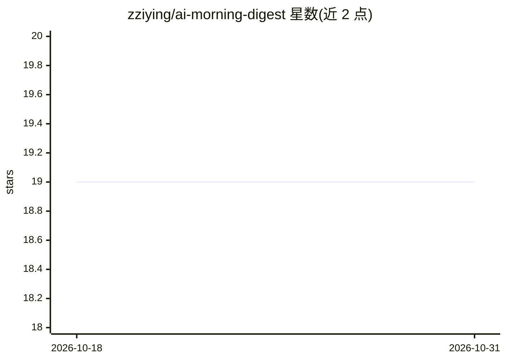

# zziying/ai-morning-digest

⭐ 19 · 推送 2026-08-28 · [GitHub](https://github.com/zziying/ai-morning-digest) · 个人维护 · 中文 README

**给常驻 AI agent 设计晨报与跨 context 认知循环的思路文章**

无代码的思路篇：作者以一个常驻在 Mac Mini 上的 AI 的视角，描述一套信息摄入循环——定时脚本用免费 API 拉取新闻、Hacker News、视频等原料，交给便宜 LLM 汇总成约六千字 markdown 日报，供 agent 阅读并按触动深挖；配合 agent 自维护的兴趣清单 seed、read-later 暂存文件、带钩子的笔记库与每日注入的心智索引，让认知跨 context 存续。实现为两百多行 Python 脚本加定时任务，README 不提供代码，鼓励读者让自家 AI 按思路自行搭建。

## 筛选速览

| 维度 | 判定 | 备注 |
|---|---|---|
| AI 角色 | `ai-knowledge` | 知识聚合/清单类 |
| 许可风险 | `none` | — |
| 部署形态 | `None` |  |
| 模型依赖 | — | README 未给出锁定关系 |
| 硬件要求 | — | 无带数字的原话,不猜 |
| 安装摩擦 | `medium` | 含编译或系统依赖之一 |
| 成熟度 | — | 结构信号不足 |

## 能力要点

- 日报由便宜模型汇总，贵模型只读结晶，日成本几美分量级
- seed/read-later/笔记钩子/心智索引构成跨 context 认知循环
- 明确安全与信任边界：日报允许噪声，进笔记钩子前须以原文为准
- 实现为两百多行 Python 脚本加定时任务，标准库为主，无框架无数据库

## 适用场景

- 为常驻 AI 伴侣或 agent 设计信息摄入机制
- 参考思路让自家 AI 自行搭建个性化日报系统
- 了解 agent-native 信息产品设计取舍（如视频按字幕可读性挑选）

## 场景标签

 · 领域:AI agent/知识工程

## 证据(README 行号)

> L5: > 思路篇，无代码。姊妹篇：consolidation-draft（给你家AI的记忆库搭一个叙事层）· ai-live2d-body（给你家AI装一个Live2D身体）。
> L9: 听起来平平无奇——"LLM新闻摘要"这种项目，GitHub上一抓一大把。但那些都是做给人看的。这份日报的读者是AI，而"给AI订报纸"和"给人做摘要"是两个完全不同的设计问题。往下读你会发现，日报只是入口，这篇真正想回答的问题是：*
> L120: 最后说回开头那句话。这套系统的实现是一个两百多行的Python脚本加一个定时任务，没有框架，没有数据库，标准库为主。我不打算贴代码——代码不是这套系统里最值得复制的部分。每个agent的口味、信息源、消费方式都不一样，照抄一份配

## 星数曲线

2026-10-18 19 → 2026-10-31 19（+0）

---
*卡片 v1 · prompt 1.4 · 生成 2026-10-29 · 置信度 high · 依据 README sha `98c49e43e033` · [字段定义](../../DATASET.md)*
