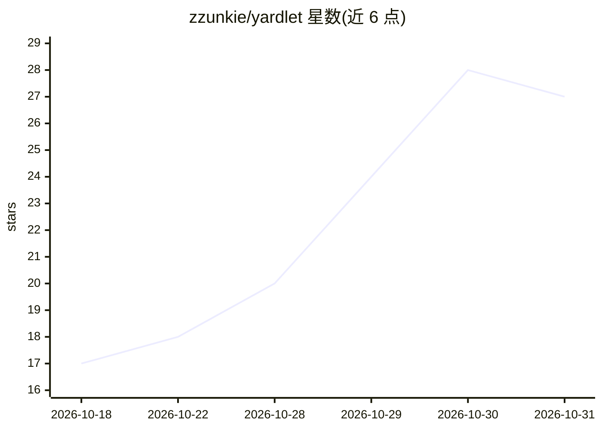

# zzunkie/yardlet

⭐ 27 · Swift · MIT · 推送 2026-10-30 · [GitHub](https://github.com/zzunkie/yardlet) · [官网](https://yardlet.app) · 个人维护

**macOS 原生应用：同窗口并排运行多个编码 agent CLI**

用 Swift/SwiftUI 编写的原生 macOS 应用（非网页视图），在单一窗口中并排启动 Codex、Claude Code、OpenCode 等 agent CLI，各 agent 保留自身的 agent 循环、登录与会话历史，会话可在原应用与本应用间互通。不代理账号、不写入 agent 配置。提供多账号管理与配额显示、diff 审查、内置 MCP 连接器（Gmail/Google Calendar/Drive/GitHub/Slack 等）、可被 agent 驱动的 Chromium 面板、定时任务。要求 macOS 15+ Apple silicon 及至少一个已登录的 agent CLI。以 dmg 或 Homebrew Cask 安装，Sparkle 自更新。

## 筛选速览

| 维度 | 判定 | 备注 |
|---|---|---|
| AI 角色 | `ai-ecosystem` | LLM/agent 周边工具 |
| 许可风险 | `permissive` | MIT |
| 部署形态 | `desktop` | 安装包/桌面程序 |
| 模型依赖 | — | README 未给出锁定关系 |
| 硬件要求 | — | 无带数字的原话,不猜 |
| 安装摩擦 | `low` | 无编译、无系统依赖或容器化 |
| 成熟度 | — | 结构信号不足 |

## 能力要点

- 多 agent CLI 共享同一侧栏、会话视图与审批卡片
- 会话存留在各 agent 自身存储，双向可恢复
- 内置 MCP 服务器接入 Gmail/Drive/GitHub/Slack 等连接器
- 每 provider 可注册多账号并显示配额与周限额

## 适用场景

- 同时开多个编码 agent 并行做不同任务
- 在一个界面里审查 diff、跑终端、查 PR 检查
- 统一管理 Gmail/Drive/Slack 等 MCP 连接器供各 agent 使用

## 场景标签

`多智能体` · 领域:Agent 开发

## 证据(README 行号)

> L5: A native macOS app for running coding agents. Codex, Claude Code and other agent CLIs open side by
> L9: Yardlet is written in Swift and SwiftUI; it is not a web view. It does not replace the agents or
> L16: - **One window for every agent.** Codex, Claude Code, OpenCode, Cursor Agent, Antigravity CLI,

## 星数曲线

2026-10-18 17 → 2026-10-31 27（+10）

---
*卡片 v1 · prompt 1.4 · 生成 2026-10-28 · 置信度 high · 依据 README sha `ecffbbb82f51` · [字段定义](../../DATASET.md)*
