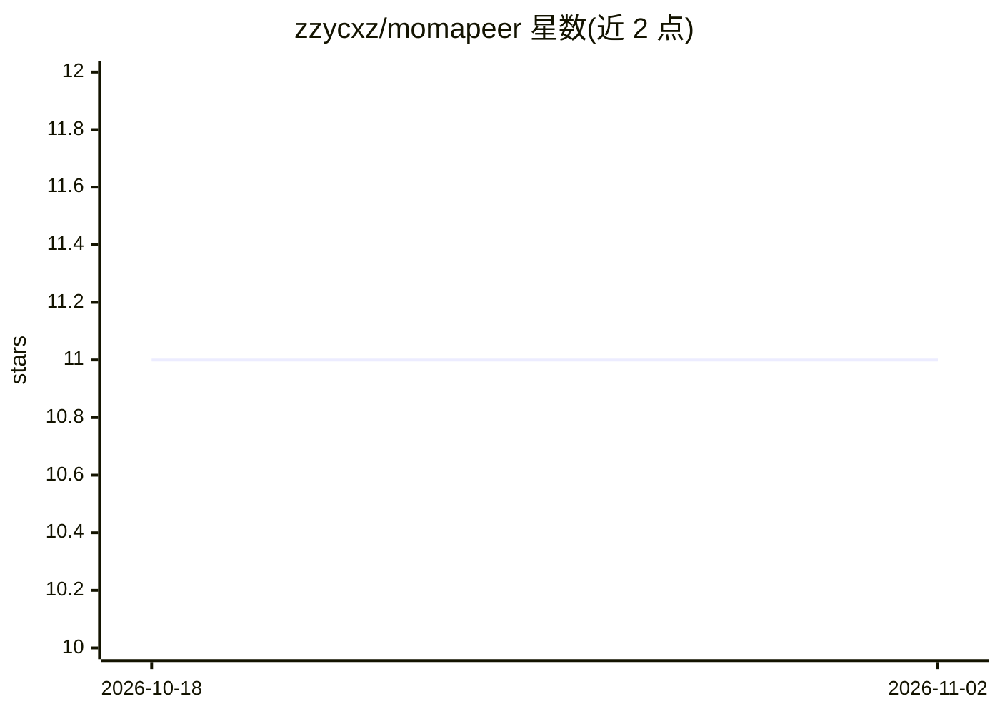

# zzycxz/momapeer

⭐ 11 · Go · MIT · 推送 2026-08-06 · [GitHub](https://github.com/zzycxz/momapeer) · 个人维护 · 中文 README

**对接中国移动九天(MoMA)平台的AI编程助手，单二进制多端运行**

基于 DeepSeek-Reasonix 二次开发的 AI 编程 Agent，专为中国移动九天(MoMA)模型平台打造：通过 JIUTIAN_API_KEY 接入九天平台上的 300+ 模型（DeepSeek、Qwen、GLM 等），以 momapeer.toml 配置驱动。同一 Go 单二进制核心支持终端 TUI、Wails 桌面客户端、HTTP/SSE 服务、企业微信/飞书/QQ 机器人与 ACP 五种前端形态。内置 IDE 级工具链、基于 tree-sitter+SQLite 的本地代码图谱、MCP 插件体系、Plan 模式人工签核与检查点回滚，另有 Dream/Distill 周期性知识沉淀机制。安装提供 npm、brew 与源码编译（需 Go 1.25+）。

## 筛选速览

| 维度 | 判定 | 备注 |
|---|---|---|
| AI 角色 | `ai-native` | 本体是模型或模型工具 |
| 许可风险 | `permissive` | MIT |
| 部署形态 | `library` | 以包/库形式分发 |
| 模型依赖 | — | README 未给出锁定关系 |
| 硬件要求 | — | 无带数字的原话,不猜 |
| 安装摩擦 | `medium` | 含编译或系统依赖之一 |
| 成熟度 | — | 结构信号不足 |

## 能力要点

- 接入九天(MoMA)平台 300+ 模型，支持 thinking mode 协议与 16 个预置模型定价
- 单一静态 Go 二进制，TUI/桌面/API 服务/IM 机器人/ACP 五种前端形态
- CodeGraph 引擎基于 tree-sitter+SQLite 建立本地代码图谱，LSP 集成
- Plan Mode 高危操作人工签核、检查点 /rewind 撤销、权限 glob 审批

## 适用场景

- 企业内通过九天平台密钥使用 AI 编程助手完成编码与重构
- 在终端或桌面客户端以自然语言驱动 Agent 实现 TODO 与补测试
- 通过企业微信/飞书/QQ 机器人让团队使用编码 Agent
- 以 MCP 插件与 subagent skill 扩展浏览器自动化、邮件、知识库等能力

## 场景标签

`编码 Agent` · 领域:编码与开发

## 证据(README 行号)

> L16:  中国移动九天原生的企业级全场景 AI 编程助手。
> L23: momapeer 是一款专为中国移动九天 (MoMA) 平台生态打造的 AI 智能编程助手，以高度可配置化和 MCP 插件体系为核心驱动力。
> L26: Agent 可以在 **终端**（TUI）、**桌面客户端**（基于 Wails）、**HTTP/SSE 服务器** 或 **多通道 IM 机器人**（企业微信 / 飞书 / QQ）等全场景中运行——所有前端均由同一个高性能、传输

## 星数曲线

2026-10-18 11 → 2026-11-02 11（+0）

---
*卡片 v1 · prompt 1.4 · 生成 2026-11-01 · 置信度 high · 依据 README sha `5319a396d8b4` · [字段定义](../../DATASET.md)*
