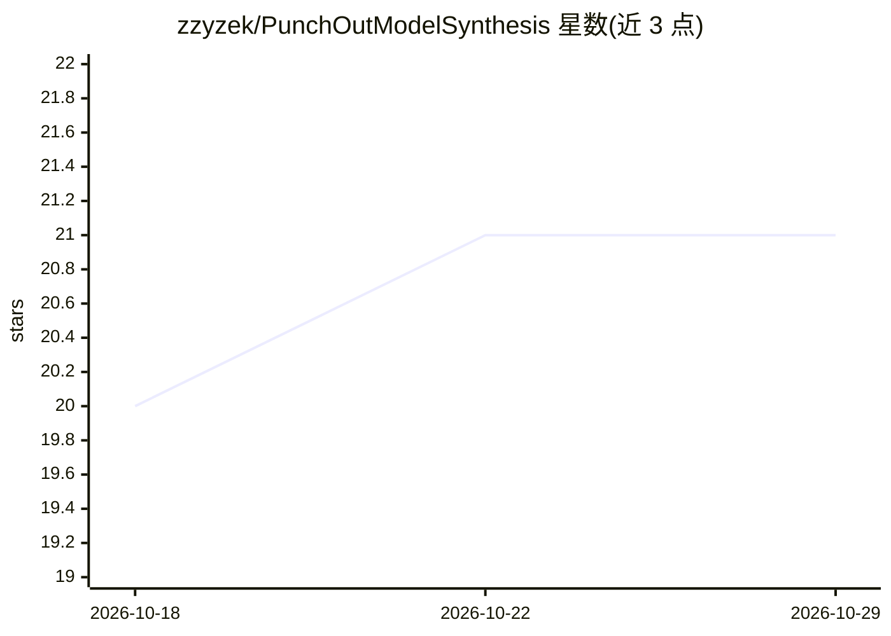

# zzyzek/PunchOutModelSynthesis

⭐ 21 · JavaScript · CC0-1.0 · 推送 2026-02-01 · [GitHub](https://github.com/zzyzek/PunchOutModelSynthesis) · 个人维护

**基于约束的贴图生成算法（POMS），供关卡/关卡集生成**

Punch Out Model Synthesis 是一种基于约束的贴图生成（CBTG）算法，扩展 Merrell 的 modify-in-block Model Synthesis 与 Gumin 的 Wave Function Collapse 算法，可在初始化要求极低的情况下处理大网格。项目附带从示例 2D 图像自动创建贴图集与贴图规则约束的工具集、程序化生成 3D 贴图集的示例代码，以及供高级用户使用的运行可视化 Web 应用。源码以 C/C++ 形式提供，通过 git clone 后 make 编译运行；作者声明这是研究质量代码，可能发生变化。

## 筛选速览

| 维度 | 判定 | 备注 |
|---|---|---|
| AI 角色 | `ai-native` | 本体是模型或模型工具 |
| 许可风险 | `viral` | CC0-1.0 |
| 部署形态 | `None` |  |
| 模型依赖 | — | README 未给出锁定关系 |
| 硬件要求 | — | 无带数字的原话,不猜 |
| 安装摩擦 | `low` | 无编译、无系统依赖或容器化 |
| 成熟度 | `idea` | |

## 能力要点

- 扩展 MMS 与 WFC 的约束贴图生成算法，支持大网格、低初始状态要求
- 从示例 2D 图像自动生成贴图集与规则约束的工具集
- 3D 贴图集程序化生成示例代码
- 运行可视化辅助 Web 应用

## 适用场景

- 游戏关卡或地图的程序化生成
- 从美术示例图自动构建贴图集与拼接规则
- 研究/复现 WFC 与 Model Synthesis 类算法并可视化运行过程

## 场景标签

 · 领域:游戏开发/程序化生成算法

## 证据(README 行号)

> L7: Punch Out Model Synthesis (POMS) is a Constraint Based Tiling Generation (CBTG) algorithm,
> L8: extending Merrell's modify in block Model Synthesis (MMS) and Gumin's Wave Function Collapse (WFC)

## 星数曲线

2026-10-18 20 → 2026-10-29 21（+1）

---
*卡片 v1 · prompt 1.4 · 生成 2026-10-28 · 置信度 mid · 依据 README sha `fabdbb1b6649` · [字段定义](../../DATASET.md)*
