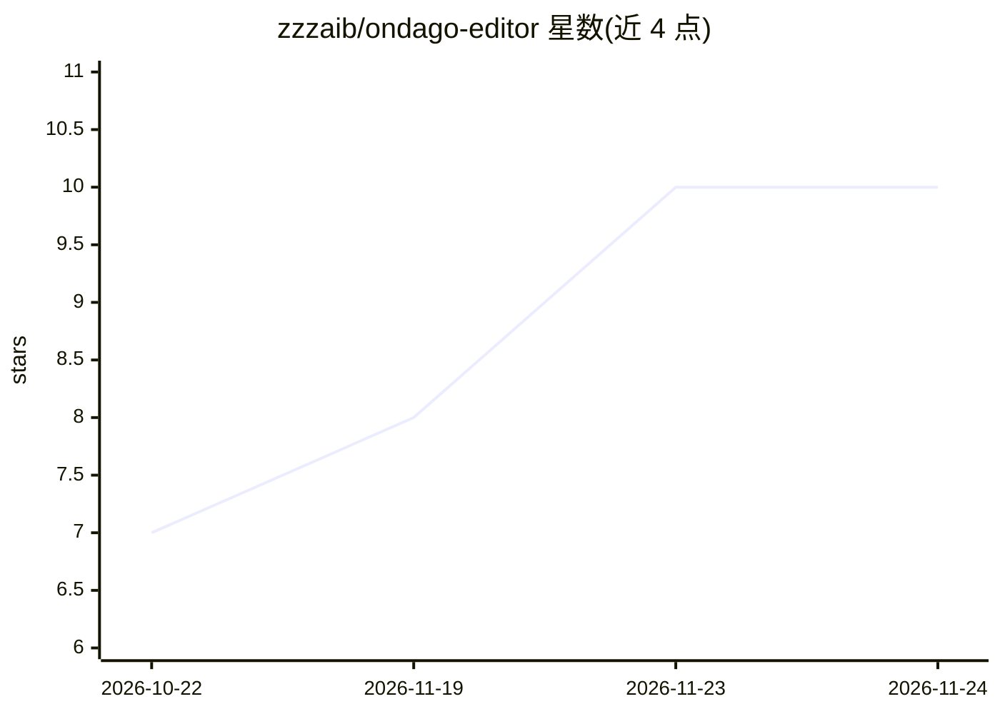

# zzzaib/ondago-editor

⭐ 11 · Python · MIT · 推送 2026-11-21 · [GitHub](https://github.com/zzzaib/ondago-editor) · [官网](www.zaan.tech) · 个人维护

**离线 AI 视频剪辑桌面应用：录屏素材一键产出 YouTube 视频与 Reels**

面向 Windows 与 macOS（Apple Silicon 及 Intel）的桌面应用，读取原始录制视频，自动执行静默/口头填充词/重录片段删除、逐词动态字幕（英文与 Hinglish）、B-roll 插入、变焦、音效、缩略图、标题与描述生成，输出 16:9 YouTube 视频与 9:16 Reels 并支持上传。AI 全部本地运行：通过内置便携 Ollama 运行 Qwen 模型作为编辑决策，Whisper 转录，SigLIP 检索本地 B-roll 素材库，另支持从手机浏览器远程操控剪辑。提供 Releases 安装包，安装器按 GPU 自动选择 CUDA 版 PyTorch。

## 筛选速览

| 维度 | 判定 | 备注 |
|---|---|---|
| AI 角色 | `ai-native` | 本体是模型或模型工具 |
| 许可风险 | `permissive` | MIT |
| 部署形态 | `desktop` | 安装包/桌面程序 |
| 模型依赖 | local-ok | 支持本地模型 |
| 硬件要求 | `cpu-ok` | |
| 安装摩擦 | `medium` | 含编译或系统依赖之一 |
| 成熟度 | — | 结构信号不足 |

## 能力要点

- 一键完成剪切、字幕、B-roll、缩略图到 YouTube/Instagram 双格式输出
- Hinglish 字幕：专用印地语→罗马字转写模型
- 全流程本地推理：内置 Ollama + Qwen + Whisper + SigLIP 等模型
- v2 支持从手机（浏览器/PWA）远程操控剪辑与发布

## 适用场景

- 把原始录制一键剪辑成 YouTube 视频和 Instagram Reels
- 为印地英语口音的视频生成罗马字 Hinglish 字幕
- 无网络/无云端环境下本地完成 AI 剪辑
- 用手机远程提交素材并监控剪辑进度

## 场景标签

`图像视频处理` · 领域:感知与多模态

## 证据(README 行号)

> L5: OnDaGo Editor is a one-click desktop app for **Windows and macOS** (Apple Silicon M1/M2/M3/M4 and Intel Macs). It cu
> L95: |**RTX 20 / 30 / 40 / 50 series** (e.g. 2060 Super, 3060, 3070 Ti, 4060, 4070, 5070)|8 GB+|**Everything**, includin

## 星数曲线

2026-10-22 7 → 2026-11-24 10（+3）

---
*卡片 v1 · prompt 1.4 · 生成 2026-11-20 · 置信度 high · 依据 README sha `fe8f7abadd4f` · [字段定义](../../DATASET.md)*
